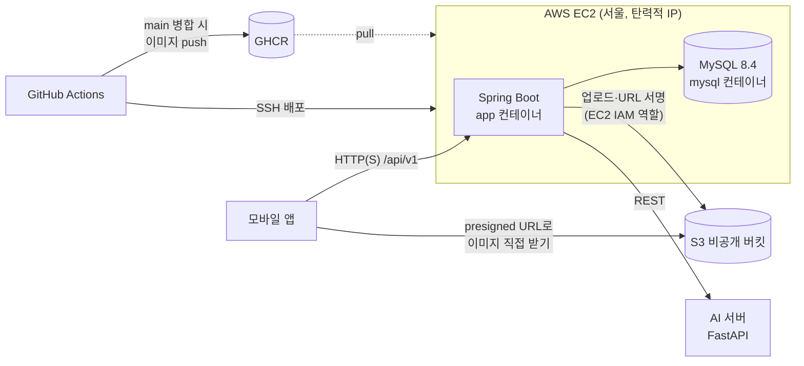

# 아키텍처

「온나」 백엔드의 구성과 핵심 규칙을 한 장으로 정리합니다. 테이블은 [ERD](ERD.md), 기술 결정의 이유는 [ADR](adr/)에 있습니다.

## 구성



| 구성 요소 | 하는 일 | 상태 |
|---|---|---|
| Spring Boot | API, 거리·공개 시각·익명 판정 | 개발 중 |
| MySQL | 테이블 8개 ([ERD](ERD.md)) | 로컬 적용, 서버 예정 |
| S3 | 단계별 이미지 저장, presigned URL ([ADR 0002](adr/0002-s3-image-storage.md)) | 예정 |
| AI 서버 | 해시태그 후보, 얼굴 감지, (P1) 경로 추천 | 예정 |
| EC2 + GitHub Actions + GHCR | main 병합 시 자동 배포 ([ADR 0003](adr/0003-deploy-ec2-docker-ghcr.md)) | 예정 |

## 핵심 규칙: 서버가 판정한다

앱이 보낸 값을 그대로 믿지 않습니다. 거리, 공개 시각, 익명성은 모두 서버에서 정합니다.

### 1. 거리별 공개 단계

사용자 좌표와 사진의 흐린 좌표 사이 거리(하버사인, `GeoUtils.distance`)로 단계를 정합니다(`BlurStage.of`).

| 거리 | 단계 | 이미지 |
|---|---|---|
| 150m 초과 | S0 | 24px |
| 60m 초과 ~ 150m | S1 | 64px |
| 25m 초과 ~ 60m | S2 | 160px |
| 25m 이하 | OPEN | 1080px + 한 줄 |

- 경계값은 가까운 쪽 단계에 넣습니다(정확히 25m면 OPEN).
- 위치 오차(`accuracy`)가 50m를 넘으면 OPEN 대신 S2까지만 줍니다. 열기 요청이면 `RETRY_LOCATION`으로 다시 측정하게 합니다.
- 경계값은 `application.properties`의 `app.blur.*`로 빼 두었고, 현장 테스트 후 조정합니다.
- 응답에는 판정된 단계의 이미지 주소 하나만 넣습니다. 더 선명한 단계 주소는 내려가지 않습니다.

### 2. 위치 보호

- 업로드 좌표는 20m 격자에 맞춘 뒤(`GeoUtils.snap`) 랜덤 오프셋을 더한 **흐린 좌표만** 저장합니다. 원본 좌표와 EXIF는 저장하지 않습니다.
- 업로드 좌표는 반경 안에서 가장 가까운 구역(zone)에 배정합니다(`MapService.findZone`). 구역 밖이면 배정하지 않습니다.

### 3. 지연 공개

- `publish_at = 업로드 시각 + 120~180분`. 남의 사진 조회는 모두 `status = VISIBLE AND publish_at <= now` 조건이 들어간 공용 Repository 메서드를 씁니다([ERD 공용 조회 규칙](ERD.md#공용-조회-규칙)).
- 본인 사진은 이 조건 없이 바로 보입니다.

### 4. 익명

- 남의 사진 응답에는 작성자 정보와 좋아요 수를 넣지 않습니다. DTO에 필드 자체를 두지 않습니다.

## 코드 구조

```
controller  요청·응답만 (ResponseEntity)
service     판단 로직 (거리 단계, 공개 조건, 점수)
repository  JpaRepository, 공용 조회 메서드
domain      엔티티 8개
dto         XxxReqDto / XxxResDto
ai          AI 서버 클라이언트
global      config, security, exception, util(GeoUtils, BlurStage, BlurProperties)
```

파일별 담당과 서로 넘겨줄 메서드는 [협업 규칙](CONVENTIONS.md#파일-담당)에 있습니다.
