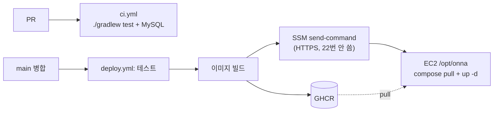

# 배포

개발 서버의 구성, 처음 한 번 하는 준비, 평소 배포·되돌리기·장애 대응 절차입니다. 왜 이렇게 정했는지는 [ADR 0003](adr/0003-deploy-ec2-docker-ghcr.md)에 있습니다.

## 한눈에



| 항목 | 값 |
|---|---|
| 리전 | `ap-southeast-2` (시드니). 이유는 [트러블슈팅 T-004](TROUBLESHOOTING.md#t-004-ec2를-서울이-아닌-시드니-리전에-생성) |
| 인스턴스 | `KkoKko-server`, t3.small, Ubuntu 24.04 |
| 주소 | 탄력적 IP (주소는 팀 단톡에 공유, 문서에는 적지 않음) |
| 서버 디렉토리 | `/opt/onna` (`compose.prod.yaml`, `.env`) |
| 컨테이너 | `onna-app` (Spring, 80→8080), `onna-mysql` (외부 포트 없음) |
| 이미지 | `ghcr.io/dandi-kkokko/kkokko_backend:latest`, `:<커밋 SHA>` |
| 서버 접속 | AWS 콘솔 → Systems Manager → Session Manager (브라우저) |

## 저장소 파일

| 파일 | 역할 |
|---|---|
| `Dockerfile` | 멀티스테이지. JDK로 `bootJar` 빌드 → JRE 이미지에서 비root 사용자로 실행 |
| `.dockerignore` | `.env`, `*.pem`, `.git`, 빌드 산출물을 빌드 컨텍스트에서 뺀다 |
| `compose.prod.yaml` | 서버용 app + mysql. 비밀값은 서버 `.env`에서 읽는다 |
| `.github/workflows/ci.yml` | PR마다 테스트. MySQL 서비스 컨테이너 사용 |
| `.github/workflows/deploy.yml` | main push 시 테스트 → GHCR push → SSM으로 서버 재시작 |

## 처음 한 번 하는 준비

### AWS

1. **EC2 IAM 역할**: `kkokko-ec2-ssm-role` (`AmazonSSMManagedInstanceCore`)을 인스턴스에 연결한다. Session Manager와 Run Command가 이 역할로 동작한다.
2. **배포용 IAM 사용자**: Actions가 쓸 사용자. 권한은 이 인스턴스에 `AWS-RunShellScript` 명령을 보내고 결과를 조회하는 것만 준다.
   - 이 계정은 GitHub OIDC를 쓸 수 없어서 액세스 키를 쓴다 ([T-007](TROUBLESHOOTING.md#t-007-github-oidc-연동-불가)).
3. **보안 그룹**: 80번만 연다. 22번은 열지 않는다(서버 접속은 Session Manager).

### GitHub (저장소 Settings)

| 종류 | 이름 | 값 |
|---|---|---|
| Secret | `AWS_ACCESS_KEY_ID` | 배포용 IAM 사용자 키 |
| Secret | `AWS_SECRET_ACCESS_KEY` | 〃 |
| Variable | `EC2_INSTANCE_ID` | 인스턴스 ID |

- 첫 배포 후 GHCR 패키지 `kkokko_backend`의 공개 범위를 **Public**으로 바꾼다(조직 Packages → Package settings). 서버가 로그인 없이 이미지를 받기 위해서다. 이미지에는 비밀값이 없다.

### 서버 (Session Manager에서)

```bash
# 패키지 업데이트, Docker 설치
sudo apt-get update && sudo apt-get upgrade -y
curl -fsSL https://get.docker.com | sudo sh

# 스왑 2GB (t3.small 메모리 2GB에 Spring + MySQL)
sudo fallocate -l 2G /swapfile && sudo chmod 600 /swapfile
sudo mkswap /swapfile && sudo swapon /swapfile
echo '/swapfile none swap sw 0 0' | sudo tee -a /etc/fstab

# 배포 디렉토리
sudo mkdir -p /opt/onna
```

`.env`는 **담당자가 직접** 만든다. 키 이름은 저장소 `.env.example`과 같고 값은 문서·채팅에 남기지 않는다.

```bash
sudo vi /opt/onna/.env      # DB_NAME, DB_USERNAME, DB_PASSWORD, DB_ROOT_PASSWORD, JWT_SECRET
openssl rand -hex 32        # JWT_SECRET 값 만들기 (서버에서 바로 만들어 채팅에 남기지 않는다)
sudo chmod 600 /opt/onna/.env
```

## 평소 배포

main에 병합하면 끝입니다. 진행 상황은 GitHub → Actions → Deploy에서 봅니다.

- 수동 재배포: Actions → Deploy → **Run workflow**
- 서버에서 확인 (Session Manager):

```bash
cd /opt/onna
sudo docker compose -f compose.prod.yaml ps
sudo docker compose -f compose.prod.yaml logs --tail=100 app
```

## 되돌리기

문제가 있는 커밋이 배포되면 이전 커밋 SHA의 이미지로 되돌립니다.

```bash
cd /opt/onna
sudo IMAGE_TAG=<이전 커밋 SHA> docker compose -f compose.prod.yaml up -d app
```

그다음 main에서 원인 커밋을 revert하는 PR을 올립니다. 다음 배포가 다시 `latest`를 씁니다.

## 장애 대응

| 증상 | 볼 곳 |
|---|---|
| Deploy 워크플로 실패 | Actions 로그의 SSM 출력(stdout/stderr) |
| SSM 명령이 안 감 | Systems Manager → Fleet Manager에서 노드가 Online인지 |
| 앱이 안 뜸 | `docker compose logs app` (DB 접속 정보, 프로필) |
| DB가 안 뜸 | `docker compose logs mysql`, 디스크 용량 `df -h` |
| 메모리 부족 | `free -h`, 스왑이 켜져 있는지 |

해결한 문제는 [트러블슈팅](TROUBLESHOOTING.md)에 기록합니다.
