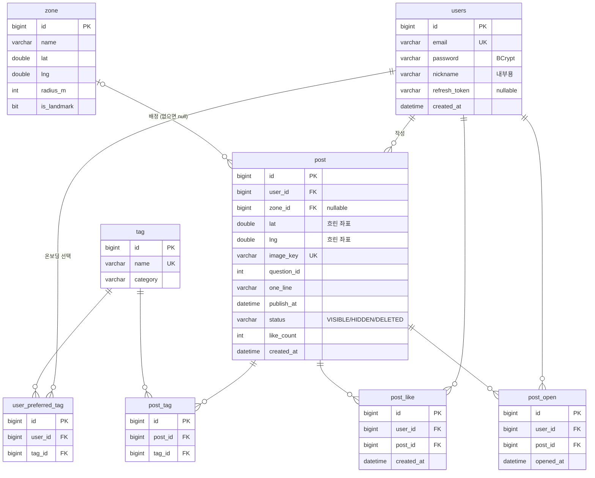

# ERD

P0 테이블은 8개입니다. 질문 목록과 업적은 테이블 없이 코드 상수와 집계 쿼리로 처리합니다.
스키마는 JPA 엔티티(`domain` 패키지)가 원본이고, `ddl-auto=update`로 생성됩니다.

## 테이블

### users
| 컬럼 | 타입 | 제약 | 설명 |
|---|---|---|---|
| id | bigint | PK | |
| email | varchar(100) | NOT NULL, UNIQUE | 로그인 아이디 |
| password | varchar(255) | NOT NULL | BCrypt 해시 |
| nickname | varchar(30) | NOT NULL | 내부용. 남에게 노출하지 않음 |
| refresh_token | varchar(512) | | 사용자당 하나만 저장 |
| created_at | datetime(6) | NOT NULL | |

- 테이블 이름 `user`는 MySQL 예약어라서 `users`로 씁니다.
- 온보딩 완료 여부는 컬럼을 두지 않고 `user_preferred_tag`에 행이 있는지로 판단합니다.

### tag
| 컬럼 | 타입 | 제약 | 설명 |
|---|---|---|---|
| id | bigint | PK | |
| name | varchar(50) | NOT NULL, UNIQUE | 예: "말없이 챙겨준 사람" |
| category | varchar(50) | NOT NULL | |

- 속정 유형 고정 사전(15~20개)입니다. `data.sql`로 넣습니다.
- AI는 이 사전 안에서만 후보를 고르고, 사전에 없는 id는 서버가 버립니다.

### user_preferred_tag
| 컬럼 | 타입 | 제약 |
|---|---|---|
| id | bigint | PK |
| user_id | bigint | FK → users, NOT NULL |
| tag_id | bigint | FK → tag, NOT NULL |

- UNIQUE(user_id, tag_id)
- 온보딩에서 고른 태그입니다. 대표 사진의 취향 점수에 쓰입니다.

### zone
| 컬럼 | 타입 | 제약 | 설명 |
|---|---|---|---|
| id | bigint | PK | |
| name | varchar(50) | NOT NULL | 건물 이름 (예: F1동) |
| lat, lng | double | NOT NULL | 구역 중심 좌표 |
| radius_m | int | NOT NULL | 업로드 좌표가 이 반경 안이면 이 구역에 배정 |
| is_landmark | bit | NOT NULL | 랜드마크는 대표 사진 최대 2장 |

- 건물 단위이고, 팀이 구글맵에서 좌표를 찍어 `data.sql`로 넣습니다.

### post
| 컬럼 | 타입 | 제약 | 설명 |
|---|---|---|---|
| id | bigint | PK | |
| user_id | bigint | FK → users, NOT NULL | 작성자. 공개 응답에는 싣지 않음 |
| zone_id | bigint | FK → zone | 반경 안에 구역이 없으면 null |
| lat, lng | double | NOT NULL | **흐린 좌표** (격자 스냅 + 랜덤 오프셋) |
| image_key | varchar(100) | NOT NULL, UNIQUE | 이미지 경로 규칙의 기준 키 |
| question_id | int | NOT NULL | 코드 상수 질문 목록의 id |
| one_line | varchar(100) | NOT NULL | 한 줄 |
| publish_at | datetime(6) | NOT NULL | 공개 시각 = 업로드 시각 + 120~180분 |
| status | varchar(20) | NOT NULL | VISIBLE / HIDDEN / DELETED |
| like_count | int | NOT NULL | 작성자 본인에게만 노출 |
| created_at | datetime(6) | NOT NULL | |

- 인덱스
  - `idx_post_zone_status_publish (zone_id, status, publish_at)`: 지도·구역 목록 조회용
  - `idx_post_lat_lng (lat, lng)`
- 이미지 경로: `{image_key}/s0.jpg`, `s1`, `s2`, `open`, `original`

### post_tag
| 컬럼 | 타입 | 제약 |
|---|---|---|
| id | bigint | PK |
| post_id | bigint | FK → post, NOT NULL |
| tag_id | bigint | FK → tag, NOT NULL |

- UNIQUE(post_id, tag_id)

### post_like
| 컬럼 | 타입 | 제약 |
|---|---|---|
| id | bigint | PK |
| user_id | bigint | FK → users, NOT NULL |
| post_id | bigint | FK → post, NOT NULL |
| created_at | datetime(6) | NOT NULL |

- UNIQUE(user_id, post_id)
- 열어 본(post_open이 있는) 사진에만 누를 수 있습니다.

### post_open
| 컬럼 | 타입 | 제약 |
|---|---|---|
| id | bigint | PK |
| user_id | bigint | FK → users, NOT NULL |
| post_id | bigint | FK → post, NOT NULL |
| opened_at | datetime(6) | NOT NULL |

- UNIQUE(user_id, post_id)
- 처음 연 시각만 남기고, 다시 열어도 갱신하지 않습니다.
- 좋아요 자격, 발견 업적, "처음 연 사람" 계산에 씁니다.

## 설계 이유

| 결정 | 이유 |
|---|---|
| 흐린 좌표만 저장, 원본 좌표·EXIF는 저장하지 않음 | 서버가 털리거나 개발자가 DB를 봐도 집 앞 같은 실제 위치가 드러나지 않게 하기 위해 |
| 지연 공개를 `publish_at` 조건으로 처리 | 남의 조회에 `publish_at <= now()`만 붙이면 되므로 스케줄러가 필요 없다 |
| 삭제는 `status = DELETED`로만 표시 | 좋아요·열람 기록이 사진을 참조하고 있어서 행을 지우면 FK가 깨진다 |
| `status`를 varchar로 저장 | MySQL 네이티브 enum이면 값을 추가할 때 `ddl-auto=update`가 컬럼을 고치지 않는다 |
| `like_count`를 컬럼으로 두고 UPDATE 쿼리로 증감 | 대표 사진 점수 계산 때마다 집계하지 않기 위해서. 동시에 눌려도 수가 어긋나지 않게 엔티티 필드가 아니라 DB에서 바로 더한다 |
| 연관관계는 단방향 `@ManyToOne(LAZY)`만 | 엔티티 간 참조를 단순하게 두고, 목록의 태그는 `post_id IN (...)` 한 번으로 가져와 N+1을 피한다 |
| 질문 목록·업적은 테이블 없음 | 내용이 고정이고 개수가 적어 코드 상수와 집계 쿼리로 충분하다 |

## 공용 조회 규칙

| 조회 | 조건 | Repository 메서드 |
|---|---|---|
| 남의 사진 (지도, 구역 목록, 열기) | `status = VISIBLE AND publish_at <= now` | `PostRepository.findVisibleByZoneIdIn`, `findVisibleById` |
| 내 사진 (내 기록) | `status <> DELETED`, 공개 시각 조건 없음 | `PostRepository.findByUserIdAndStatusNotOrderByCreatedAtDesc` |

이 규칙은 `PostRepositoryTest`가 검증합니다.
