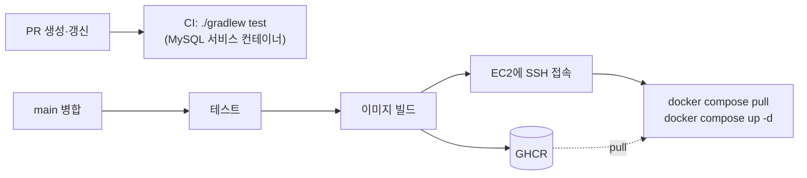

# ADR 0003. EC2 + Docker Compose + GitHub Actions(GHCR)로 자동 배포한다

- 날짜: 2026-10-29
- 상태: 채택 (구현 중)

## 배경

- 프론트는 API 명세서를 보고 바로 개발 서버에 붙는다. 그래서 **main에 병합될 때마다 개발 서버가 바로 최신이 돼야 한다.** 손으로 배포하면 병합과 서버 상태가 어긋난다.
- 심사 기준에 배포가 포함된다(개발 30점 중 배포 3점).
- 백엔드는 2명이고, 대회 기간(약 2주)만 운영한다. 비용과 관리할 것이 적어야 한다.

## 결정

| 항목 | 결정 | 이유 |
|---|---|---|
| 서버 | AWS EC2 1대, 서울 리전(`ap-northeast-2`), Ubuntu 24.04, t3.small | 사용자가 한국에 있다. Spring + MySQL을 한 대에 올릴 수 있는 최소 사양 |
| 주소 | **탄력적 IP** | 인스턴스를 재시작해도 주소가 바뀌지 않아 프론트·Secrets를 다시 고칠 필요가 없다 |
| 실행 | Docker Compose로 `app` + `mysql` 컨테이너 | 로컬(`compose.yaml`)과 같은 방식이라 환경 차이가 적다 |
| 이미지 저장소 | **GHCR** (GitHub Container Registry) | 저장소와 같은 곳에 있어 Actions의 `GITHUB_TOKEN`으로 바로 올릴 수 있다. 별도 계정·비용이 없다 |
| CI/CD | GitHub Actions | 저장소에 워크플로 파일만 두면 된다 |
| 사진 | S3 ([ADR 0002](0002-s3-image-storage.md)) | 서버 디스크와 분리 |

### 흐름

- PR: 테스트만 돌린다. 실패하면 병합하지 않는다.
- main: 테스트 → 이미지 빌드 → GHCR push → EC2에서 새 이미지를 받아 재시작.

### 비밀값

- 이미지 안에 비밀값을 넣지 않는다. DB 비밀번호 등은 **EC2의 `.env`**에 두고 compose가 컨테이너 환경변수로 넘긴다.
- 배포에 필요한 값(EC2 주소, 접속 사용자, SSH 키)은 **GitHub Secrets**에 둔다.
- SSH 키는 ED25519. 로컬에서는 `~/.ssh/keys`에 두고 저장소에는 넣지 않는다.

### 보안 그룹

| 포트 | 열린 대상 | 이유 |
|---|---|---|
| 22 (SSH) | 관리자 IP(/32) | 서버 관리 |
| 80 (HTTP) | 전체 | 앱·프론트가 접속 |
| 443 (HTTPS) | 전체 (도메인 구입 후) | iOS ATS·Android 9+는 기본으로 HTTP를 막으므로 현장 테스트(11/6) 전에 필요 |
| 3306, 8080 | 열지 않음 | DB와 Spring은 서버 안에서만 접근 |

## 결과

- 저장소에 추가할 파일: `Dockerfile`, `.dockerignore`, `compose.prod.yaml`, `.github/workflows/`(CI, 배포), `docs/DEPLOY.md`(서버 준비·재배포·장애 대응 절차).
- MySQL이 같은 서버에 있으므로 서버를 지우면 DB도 사라진다. 대회용 데이터라 감수하고, 볼륨은 유지한다.
- t3.small 메모리(약 2GB)에 Spring + MySQL을 올리므로 스왑 2GB를 잡는다.

## 정할 것

- [ ] Actions가 SSH로 접속하는 방법. GitHub 러너 IP는 매번 바뀌어서 22번을 관리자 IP로만 열면 접속이 막힌다.
  - 후보: 배포할 때만 러너 IP(/32)를 보안 그룹에 잠깐 추가하고 끝나면 지운다(보안 그룹 수정 권한만 있는 IAM 사용자).
- [ ] 도메인 구입 → Nginx + Let's Encrypt로 HTTPS
- [ ] GHCR 이미지 공개 여부(공개면 EC2에서 로그인 없이 pull 가능. 이미지에 비밀값이 없어야 한다)
- [ ] 대회 후 정리: 인스턴스 종료, 탄력적 IP 해제(보유하는 동안 계속 과금된다), S3 버킷 정리
