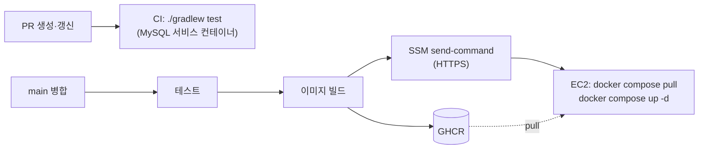

# ADR 0003. EC2 + Docker Compose + GitHub Actions(GHCR) + SSM으로 자동 배포한다

- 날짜: 2026-10-29 (2026-10-30 리전·배포 경로 수정)
- 상태: 채택 (구현 중)

## 배경

- 프론트는 API 명세서를 보고 바로 개발 서버에 붙는다. 그래서 **main에 병합될 때마다 개발 서버가 바로 최신이 돼야 한다.** 손으로 배포하면 병합과 서버 상태가 어긋난다.
- 심사 기준에 배포가 포함된다(개발 30점 중 배포 3점).
- 백엔드는 2명이고, 대회 기간(약 2주)만 운영한다. 비용과 관리할 것이 적어야 한다.
- 10/30에 확인한 제약
  - AWS 계정이 "Sign up for AWS (new)" 방식이라 **리전이 시드니로 고정**된다 ([T-004](../TROUBLESHOOTING.md#t-004-ec2를-서울이-아닌-시드니-리전에-생성)).
  - **학교 네트워크가 나가는 22번(SSH)을 막는다** ([T-006](../TROUBLESHOOTING.md#t-006-학교-네트워크에서-ssh-접속-불가)).
  - 이 계정은 **GitHub OIDC 연동을 쓸 수 없다** ([T-007](../TROUBLESHOOTING.md#t-007-github-oidc-연동-불가)).

## 결정

| 항목 | 결정 | 이유 |
|---|---|---|
| 서버 | AWS EC2 1대, **시드니(`ap-southeast-2`)**, Ubuntu 24.04, t3.small | 계정 리전 고정. 서울 대비 응답이 약 0.14초 느리지만(로컬에서 연결 시간 측정: 서울 약 17ms, 시드니 약 160ms) 앱 사용에는 지장 없다고 판단. 크레딧·지출 한도를 그대로 쓴다 |
| 주소 | **탄력적 IP** | 인스턴스를 재시작해도 주소가 바뀌지 않아 프론트 설정을 다시 고칠 필요가 없다 |
| 실행 | Docker Compose로 `app` + `mysql` 컨테이너 | 로컬(`compose.yaml`)과 같은 방식이라 환경 차이가 적다 |
| 이미지 저장소 | **GHCR** (GitHub Container Registry) | 저장소와 같은 곳에 있어 Actions의 `GITHUB_TOKEN`으로 바로 올릴 수 있다. 별도 계정·비용이 없다 |
| CI/CD | GitHub Actions | 저장소에 워크플로 파일만 두면 된다 |
| **서버에 배포 명령 보내기** | **SSM Run Command** (SSH 안 씀) | 22번을 열지 않아도 된다. GitHub 러너 IP가 매번 바뀌는 문제, 학교망 22번 차단과 무관하다 |
| 서버 접속(사람) | **SSM Session Manager** (브라우저) | 학교에서도 접속된다. 22번은 전환이 끝나면 닫는다 |
| 사진 | S3 ([ADR 0002](0002-s3-image-storage.md)) | 서버 디스크와 분리 |

### 흐름

- PR: 테스트만 돌린다. 실패하면 병합하지 않는다.
- main: 테스트 → 이미지 빌드(`latest`, 커밋 SHA 태그) → GHCR push → SSM으로 EC2에서 새 이미지를 받아 재시작.
- 절차와 되돌리기 방법은 [DEPLOY.md](../DEPLOY.md).

### 권한과 비밀값

| 무엇 | 어디에 | 권한 범위 |
|---|---|---|
| DB 비밀번호 등 | EC2 `/opt/onna/.env` (권한 600) | 이미지·저장소에 넣지 않는다 |
| EC2 IAM 역할 `kkokko-ec2-ssm-role` | 인스턴스에 연결 | `AmazonSSMManagedInstanceCore` (SSM 에이전트용) |
| 배포용 IAM 사용자 `kkokko-github-deploy` | 키를 GitHub Secrets(`AWS_ACCESS_KEY_ID`, `AWS_SECRET_ACCESS_KEY`)에 | 이 인스턴스에 `AWS-RunShellScript` 실행 + 결과 조회만. 콘솔 로그인 없음 |
| 인스턴스 ID | GitHub Variables(`EC2_INSTANCE_ID`) | 비밀값 아님 |

- 외부 Action 중 비밀값을 받는 것(docker login/build-push/buildx, aws credentials)은 커밋 SHA로 고정했다. 태그가 다른 코드로 바뀌어도 영향을 받지 않게 하기 위해서다.
- OIDC를 못 써서 오래 쓰는 액세스 키를 쓴다. 대신 권한을 위처럼 좁히고, 대회가 끝나면 키를 지운다.

### 보안 그룹

| 포트 | 열린 대상 | 이유 |
|---|---|---|
| 22 (SSH) | 관리자 집 IP(/32) → **첫 배포 확인 후 닫음** | Session Manager로 대체 |
| 80 (HTTP) | 전체 | 앱·프론트가 접속 |
| 443 (HTTPS) | 전체 (도메인 구입 후) | iOS ATS·Android 9+는 기본으로 HTTP를 막으므로 현장 테스트(11/6) 전에 필요 |
| 3306, 8080 | 열지 않음 | DB와 Spring은 서버 안에서만 접근 |

## 결과

- 저장소 파일: `Dockerfile`, `.dockerignore`, `compose.prod.yaml`, `.github/workflows/ci.yml`, `.github/workflows/deploy.yml`, `docs/DEPLOY.md`.
- MySQL이 같은 서버에 있으므로 서버를 지우면 DB도 사라진다. 대회용 데이터라 감수하고, 볼륨은 유지한다.
- t3.small 메모리(약 2GB)에 Spring + MySQL을 올리므로 스왑 2GB를 잡았다.
- S3 버킷도 EC2와 같은 시드니에 둔다(리전 간 전송 비용을 피하기 위해).

## 정할 것

- [ ] GHCR 패키지 `kkokko_backend`를 Public으로 (첫 배포 후 Package settings에서. 이미지에 비밀값이 없다)
- [ ] 첫 배포 확인 후 보안 그룹 22번 삭제
- [ ] 도메인 구입 → Nginx + Let's Encrypt로 HTTPS
- [ ] 대회 후 정리: 인스턴스 종료, 탄력적 IP 해제(보유하는 동안 계속 과금된다), S3 버킷 정리, 배포용 액세스 키 삭제
